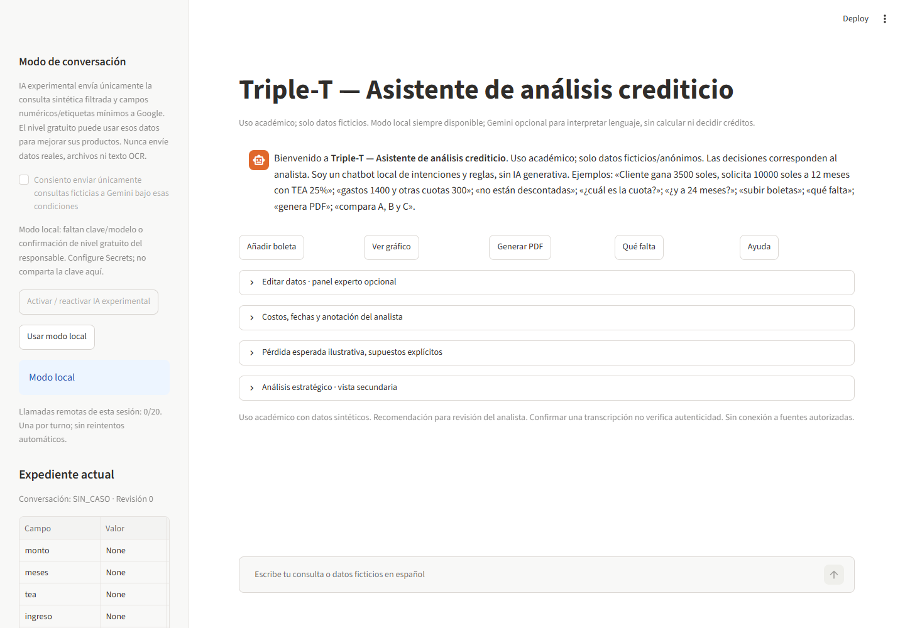

# Sprint 4 — interpretación generativa opcional

## Arquitectura y alcance

`ui_chat.py` recoge consentimiento y activación independientes. `ia/politicas.py`
prioriza el parser local; solo las frases no reconocidas o cantidades escritas
se ofrecen a Gemini. `ia/privacidad.py` bloquea posibles identificadores y construye
un contexto por lista permitida: campos numéricos, etiquetas y referencia base/escenario.
No incluye mensajes históricos, documentos, OCR, nombres de archivos ni observaciones.

`ia/proveedor.py` utiliza google-genai (verificado localmente con 1.75.0; rango >=1.30,<2),
endpoint fijo Developer API, JSON estructurado y ninguna herramienta. `ia/esquemas.py`
rechaza claves desconocidas o duplicadas, tipos/rangos incorrectos, tasas ambiguas,
entidades sin cita literal, contradicciones y acciones fuera de la lista.
`supports` es una extensión del esquema SRS para comprobar las cantidades contra
fragmentos del mensaje, incluida conversión lingüística de años a meses.
El contrato resultante sigue siendo `Interpretacion`; `conversacion/gestor.py`
mantiene confirmaciones y llama a los servicios existentes. No hay texto libre del
modelo en la respuesta ni cálculos financieros a cargo del modelo.

Solo personal PEN es evaluable. Se conservan los tres cursos estratégicos y sus
nueve escenarios, los adjuntos locales, gráficos, PDF y revisión humana.
RN-03 se explica con la fórmula y el umbral académico configurado junto al resultado.

## Configuración y operación

Seguir README y `.streamlit/secrets.toml.example`. El modelo no se elige automáticamente.
`GEMINI_FREE_TIER_CONFIRMED=true` exige que el responsable confirme disponibilidad
gratuita; el programa no conoce la facturación de su cuenta. No activar si no dispone
de nivel gratuito. Clave únicamente en entorno/Secrets del servidor, nunca en sesión,
repositorio, cliente, PDF ni logs de la aplicación.

Consentimiento y activación son explícitos. Una llamada por turno, 20 por sesión,
entrada de 2000 caracteres, contexto de 4000, salida JSON de 8192 y 1024 tokens.
Timeout HTTP de 12 segundos, espera asíncrona de 15 segundos, un intento de SDK.
El contador incluye errores y sobrevive al reinicio del caso. Fallos abren el circuito,
desactivan IA y conservan expediente, escenario e informe; no muestran excepciones
del proveedor. Reactivación consciente, sin reintento automático ni proveedor pago.
La conversación puede agregar el aviso y cambiar a aclaración pendiente.

## Verificación local (20/11/2026)

77 pruebas existentes de Sprints 1–3 pasaron, sin modificar ni excluir pruebas.
Se respetó la indicación previa del usuario de no implementar nuevas pruebas:
las comprobaciones específicas siguientes se ejecutaron offline con proveedor
simulado e inyección de dependencias; no constituyen una nueva suite persistente.
No se usaron credenciales reales ni se llamó a Gemini.

La paráfrasis «Quisiera saber cuánto pagaría al mes por un financiamiento personal
de diez mil soles que planeo cancelar en un año, con una tasa efectiva anual del
veinticinco por ciento» aceptó el JSON simulado: monto 10000, meses 12, TEA 25.
La cuota coincidió exactamente con `servicios.finanzas.cronograma`; ingreso quedó
ausente. «¿Y si lo extiendo a dos años?» creó un escenario de 24 meses con base intacta.
Esto comprueba el contrato de integración, no la calidad del modelo real.

JSON inválido, herramienta desconocida y excepciones simuladas 429, timeout y 401
produjeron una sola llamada, circuito abierto y datos/escenario/informe intactos.
Se verificaron ausencia de llamadas sin consentimiento, configuración o presupuesto,
bloqueos DNI/correo/nombre/OCR, rechazo de decisión automática, contradicciones
atómicas y `INSUFICIENTE` con días de mora nulos. Se corrigió el bloqueo de la
marca documental `OCR_HOSTIL` detectado durante la comprobación.

| Criterio | Evidencia y estado |
|---|---|
| CA-IA-01 | Regresión Streamlit sin clave: pasa. |
| CA-IA-02 | Proveedor simulado: cero llamadas sin consentimiento. |
| CA-IA-03 | Controles implementados; falta comprobación con clave real. |
| CA-IA-04 | Paráfrasis con JSON simulado: pasa; interpretación real pendiente. |
| CA-IA-05–06 | Cuota exacta del motor e ingreso ausente: comprobados offline. |
| CA-IA-07–08 | Historial nulo y contradicciones: comprobados offline. |
| CA-IA-09 | Regresión de confirmación y cancelación existente: pasa. |
| CA-IA-10 | Escenario de 24 meses con base intacta: pasa. |
| CA-IA-11 | Regresión de estrés del motor: pasa; paráfrasis remota real pendiente. |
| CA-IA-12 | Explicación determinista implementada; revisión funcional pendiente. |
| CA-IA-13 | Solicitud de aprobación atendida localmente sin llamada. |
| CA-IA-14 | Regresión documental local: pasa; no hay adjuntos en contexto remoto. |
| CA-IA-15 | Contexto por lista permitida y bloqueo OCR comprobados offline. |
| CA-IA-16–18 | JSON/herramientas, fallos y PII: comprobaciones simuladas pasan. |
| CA-IA-19–20 | Regresión PDF/escenario y estrategia: pasa. |
| CA-IA-21 | 77/77 pruebas existentes. |
| CA-IA-22 | PENDIENTE: no se desplegó ni probó Community Cloud. |

## Riesgos y pendientes de revisión

El detector de información personal no garantiza anonimización; solo datos ficticios.
El nivel gratuito puede usar datos para mejorar productos. El límite por sesión no
impide abuso anónimo mediante sesiones nuevas; mantener IA desactivada en una demo
pública sin controles adicionales. Las citas literales reducen invenciones, pero
no prueban intención semántica ni autenticidad; pueden rechazar paráfrasis válidas.
Los números escritos complejos no soportados requieren reformulación en cifras.

El responsable debe verificar modelo/nivel gratuito, configurar Secrets sin compartir
la clave, autorizar el despliegue y comprobar consentimiento, paráfrasis real, simulación,
alertas, evidencias, PDF y fallback en Cloud. No considerar el Sprint completo en
producción hasta cerrar esos pendientes. No se fusiona ni despliega este PR.

Fuentes: [Google pricing](https://ai.google.dev/gemini-api/docs/pricing),
[SDK oficial](https://googleapis.github.io/python-genai/index.html),
[Streamlit Secrets](https://docs.streamlit.io/deploy/streamlit-community-cloud/deploy-your-app/secrets-management).

