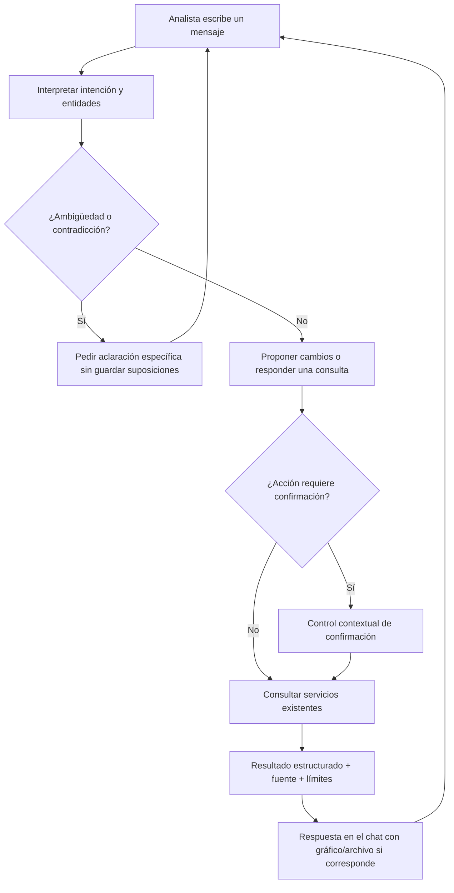

# Triple-T v2.0 — SRS del Sprint 3
## Conversación como interfaz principal, orquestación de herramientas y explicaciones verificables

**Proyecto:** Triple-T, asistente académico de apoyo al analista crediticio (caso BCP, brecha B01)
**Versión de especificación:** 1.0 — 20/11/2026
**Repositorio:** https://github.com/JuanClimacoPrada/Triple-T
**Línea base comprobada:** `main`, merge del PR #2, commit `d5329f33917477fedc3939e7c9eb3e44c8b4c81a`. Codex debe actualizar y comprobar `origin/main` antes de crear la rama.
**Estado:** requisitos para implementación, no funcionalidades ya construidas.

## 1. Problema y propósito

Los Sprints 1 y 2 implementaron motor financiero, validaciones, lectura de documentos sintéticos, confirmación de evidencias, simulaciones, gráficos y reporte PDF. La interfaz actual requiere navegar por ocho pestañas y completar diversos formularios para utilizar esas funciones. Aunque hay un chat guiado, **la experiencia no está centrada en conversar**.

**Objetivo Sprint 3:** que un analista pueda iniciar y conducir un expediente de **crédito personal en soles** principalmente mediante mensajes en español, con herramientas contextuales de confirmación, archivos, gráficos y descarga. Triple-T debe detectar la intención, extraer solo datos no ambiguos, pedir lo faltante, conservar contexto de sesión y consultar los servicios existentes para responder con evidencia. El usuario debe poder completar un flujo de principio a fin sin navegar obligatoriamente por ocho pestañas.

**Principio invariable:** Triple-T **no** toma la decisión final de aprobar o rechazar, ni genera una PD real, ni simula que verifica identidades/documentos con entidades externas. Es un prototipo académico con datos ficticios. Todas las decisiones corresponden al analista.

## 2. Alcance y exclusiones

### Incluido en Sprint 3

- Chat principal persistente **solo dentro de la sesión Streamlit**; área de resultados en línea; panel secundario opcional para ver y editar campos.
- Interpretación local, determinista y gratuita de un conjunto delimitado de intenciones en español, sin APIs externas obligatorias.
- Captura de múltiples campos en un solo mensaje; diálogo para completar campos faltantes, aclarar ambigüedades, corregir valores y confirmar cambios.
- Ejecución de los **servicios ya existentes** para análisis, amortización, documentos, simulación, gráficos, informe y comparación estratégica.
- Carga y revisión de documentos sintéticos desde un control contextual visible en el flujo conversacional; aprobación explícita de los datos transcritos.
- Preguntas de seguimiento referidas al expediente actual: «¿Cuánto pagaría?», «¿Y a 24 meses?», «¿Qué ocurre si bajan los ingresos 20%?», «Muéstrame el gráfico», «Genera el PDF».
- Respuestas con cifras, supuestos, procedencia, alertas y estado de verificación; enlaces internos de descarga cuando proceda.
- Pruebas unitarias e integrales de navegación y conversación, documentación y demostración local gratuita.
- Conservación del módulo de **3 alternativas × 3 escenarios** de la Ficha N.° 16, accesible por chat y vista secundaria.

### Excluido en Sprint 3

- Operar con expedientes personales reales o información bancaria confidencial.
- Aprobación/rechazo automático, recomendación de PD calculada con ML no entrenado o consultas inventadas a SBS, RENIEC, SUNARP, centrales de riesgo, empleadores o bancos.
- Modelo de lenguaje generativo obligatorio, integración con un proveedor de IA comercial o servicio que requiera pago o una GPU en Streamlit Community Cloud.
- Nuevas políticas crediticias oficiales o habilitación de productos vehicular, hipotecario y empresarial; deben continuar marcados «No evaluable».
- Persistencia permanente de expedientes, login bancario, autenticación de analistas o certificación regulatoria.

**Aclaración sobre IA:** la versión de este sprint será un **chatbot de lenguaje natural acotado por intenciones y reglas**, no una IA generativa. Podrá aceptar variaciones frecuentes de mensajes y responder sin inventar resultados. Una futura conexión opcional con un LLM local requerirá un sprint separado, con validación de las llamadas a herramientas. No denominarla «IA generativa integrada» en interfaz ni README antes de implementarla.

## 3. Inventario de arquitectura que debe reutilizarse

No reescribir ni duplicar motores salvo refactor mínimo justificado:

| Componente existente | Responsabilidad | Integración desde conversación |
| --- | --- | --- |
| `dominio/modelos.py` | `Expediente`, `Evidencia`, `Cargo`, `Configuracion`, `Resultado` | Entidad de estado financiero, sin duplicar reglas |
| `servicios/reglas.py` | `analizar(...)` y clasificación explicable | Evaluaciones, datos faltantes, reglas y DTI |
| `servicios/finanzas.py` | `cronograma`, fechas, TCEA referencial | Cuotas y amortización |
| `servicios/documentos.py` | `leer_archivo`, `confirmar`, `descartar`, OCR opcional | Adjuntos + confirmación estricta |
| `servicios/simulacion.py` | `simular(...)` | Escenarios sobre copia inmutable |
| `servicios/reporte.py` | `generar_pdf(...)` | Descargar reporte sin documentos crudos |
| `visualizaciones.py` | Gráficos consistentes con el resultado | Elementos desplegados junto a respuesta |
| `ui_estrategia.py` | 3 alternativas × 3 escenarios | Mantener comparaciones y acceso contextual |
| `casos.py` | Casos de demostración | Iniciar casos sin perder sus advertencias |
| `motor.py` y `reglas_credito.py` | API y compatibilidad anteriores | No romper pruebas y consumidores |

### Organización sugerida (Codex puede ajustar sin romper contratos)

```
app.py                         # Entrada Streamlit: pantalla principal de chat
conversacion/
    __init__.py
    intenciones.py             # Parser determinista; devuelve datos estructurados
    gestor.py                  # Flujo / estado de sesión; no toma decisiones bancarias
    respuestas.py              # Plantillas explicativas a partir de resultados del motor
    modelos.py                 # Mensajes, acciones, estado, campos pendientes
ui_chat.py                      # Interfaz chat; adjuntos; confirmaciones contextuales
servicios/                      # Reutilizar implementación actual
...
tests/test_sprint3.py
 docs/SPRINT_3.md
```

No es obligatorio usar estos nombres exactos, pero sí separación entre interpretación del texto, orquestación y cálculo financiero.

## 4. Modelo de conversación

**Estados funcionales** (independientes del estado financiero del expediente):

1. `SIN_CASO`: bienvenida, ayuda, ejemplos y creación de expediente.
2. `CAPTURA`: preguntas progresivas; guarda campos declarados solo si se comprenden inequívocamente.
3. `EVIDENCIA_PENDIENTE`: solicita comprobantes cuando el caso lo requiera; presenta carga y transcripción manual.
4. `CONFIRMACION_PENDIENTE`: cada dato documental candidato requiere confirmación o descarte consciente.
5. `ACLARACION_PENDIENTE`: datos contradictorios, origen de ingresos/deudas, fechas o identificadores ambiguos.
6. `ANALIZABLE`: el motor permite cálculos y una evaluación preliminar; no equivale a una aprobación.
7. `SIMULACION`: compara condiciones alternativas sin modificar los datos originales.
8. `REPORTE`: muestra resumen verificable y permite descargar PDF.

El estado de conversación no debe ocultar estados del motor (`DATOS INSUFICIENTES`, `DISCREPANCIA PENDIENTE`, `ALERTAS RELEVANTES`, `REVISIÓN ADICIONAL`, `CONDICIONES PRELIMINARES FAVORABLES`). Si hay discrepancias, prevalece el estado documentado por `servicios.reglas.analizar`.

El analista puede preguntar por una cuota teórica **antes** de completar todos los campos si monto, plazo y TEA son suficientes. La respuesta debe indicar expresamente que aún **no** se ha evaluado la capacidad de pago y enumerar lo que falta. No bloquear todas las consultas parciales por el mero hecho de que no se pueda emitir informe integral.

### Flujo funcional central



## 5. Requisitos funcionales RF-S3

| ID | Requisito obligatorio y verificable | Prioridad |
| --- | --- | --- |
| RF-S3-01 | Al abrir, mostrar título y marca **Triple-T**, bienvenida, advertencia académica y un campo de chat dominante; no comenzar obligando a recorrer formularios. | Alta |
| RF-S3-02 | Capturar en un solo mensaje datos inequívocos: monto, meses, TEA, ingreso, gastos, otras cuotas, estabilidad, historial. Mínimo reconocer las frases de pruebas de aceptación. | Alta |
| RF-S3-03 | Hacer una pregunta concreta por cada campo faltante necesario para la tarea solicitada, sin repetir datos ya confirmados. | Alta |
| RF-S3-04 | Recordar los datos del expediente, consultas y respuestas de la sesión, pero no persistirlos en disco, BD o servicios externos. | Alta |
| RF-S3-05 | Permitir corregir monto, plazo, tasa, ingresos, gastos, otras cuotas y situación de historial por chat; confirmar modificaciones sensibles y recalcular. | Alta |
| RF-S3-06 | Preguntas de seguimiento como «¿Y a 24 meses?» usan los demás parámetros anteriores; mostrar qué cambió y qué se mantiene. | Alta |
| RF-S3-07 | Ejecutar solo funciones financieras existentes con valores validados; no incluir cálculos financieros de negocio implementados por el parser. | Alta |
| RF-S3-08 | Diferenciar una cuota teórica parcial de una evaluación completa; nunca llamar «aprobado» a un resultado preliminar. | Alta |
| RF-S3-09 | Mostrar gráficos, DTI, disponible, alertas y amortización como tarjetas contextuales tras consultas; conservar una vista secundaria de detalle. | Alta |
| RF-S3-10 | Gestionar archivos PDF/PNG/JPEG ficticios desde un control contextual próximo al chat; pasar bytes exclusivamente a `servicios.documentos`. | Alta |
| RF-S3-11 | Mostrar importes/fechas candidatos con fuente, página y estado; confirmar/descarte explícito antes de usarlos en promedios. | Alta |
| RF-S3-12 | Para historial `INSUFICIENTE`, explicar por qué se solicitan 3–6 meses de ingresos; no inferir morosidad ni autenticidad documental. | Alta |
| RF-S3-13 | Si hay diferencia de ingresos superior al umbral o duplicados, solicitar aclaración con fuente y justificación; no resolver por el usuario. | Alta |
| RF-S3-14 | Simular cambio de monto/plazo/TEA/caída de ingresos sin modificar expediente ni evidencias base. Mostrar base vs escenario. | Alta |
| RF-S3-15 | Generar PDF contextual con el servicio actual; se prohíbe inventar campos, fuentes, TCEA o PD. | Alta |
| RF-S3-16 | Permitir «reiniciar», «ayuda», «qué datos tienes», «qué falta», «explica esta alerta», «muéstrame la amortización», «descarga PDF». | Alta |
| RF-S3-17 | Conservar comparación estratégica 3×3; preguntas como «compara alternativas tecnológicas» deben conducir al módulo vigente sin confundirlo con el riesgo individual. | Media |
| RF-S3-18 | Si el texto no coincide con intenciones soportadas, responder «No he podido interpretar…» y sugerir ejemplos; nunca producir números o reglas de memoria. | Alta |
| RF-S3-19 | Registrar procedencia por campo: `DECLARADO_EN_CHAT`, `EDITADO_EN_FORMULARIO`, `DOCUMENTAL_PENDIENTE`, `CONFIRMADO_ANALISTA` o equivalente compatible. | Alta |
| RF-S3-20 | Ante edición de ingreso, boletas o justificación, invalidar aclaraciones o conclusiones ya obsoletas y solicitar nueva evaluación cuando corresponda. | Alta |
| RF-S3-21 | Exponer vista opcional «Editar datos» y acciones accesibles desde el mismo contexto; permitir flujo completo sin cambiar obligatoriamente de pestaña. | Alta |
| RF-S3-22 | No habilitar análisis vehicular, hipotecario o empresarial; explicar su estado pendiente. | Alta |
| RF-S3-23 | En toda respuesta de cálculo, incluir supuestos/valores usados; en resultados de riesgo, reglas activadas y limitación de verificación. | Alta |
| RF-S3-24 | Proveer botones/tarjetas de acción rápidos cuando ayuden: «Añadir boleta», «Confirmar», «Simular», «Ver gráfico», «Generar PDF»; deben funcionar. | Media |
| RF-S3-25 | Mantener accesibilidad básica: etiquetas, mensajes visibles, contraste, uso por teclado y ausencia de bloqueos sin alternativa. | Media |

## 6. Intenciones mínimas y ejemplos de lenguaje natural

**No intentar comprender español universal sin un modelo.** Soportar explícitamente los siguientes patrones, con sinónimos y variantes de espacios/case:

| Intención | Ejemplo | Acción |
| --- | --- | --- |
| Iniciar | «Quiero evaluar un crédito personal» | Crear/continuar caso personal PEN |
| Datos múltiples | «Cliente gana S/ 3500, solicita S/ 10000 a 12 meses con TEA 25%» | Reconocer ingreso, monto, plazo, tasa; solicitar el resto |
| Deudas | «Tiene otras cuotas de 300 soles y gastos de 1400» | Añadir deudas/gastos declarados; pedir planilla descontada si necesario |
| Estado historial | «No tiene historial crediticio» | Establecer `INSUFICIENTE` solo si la frase corresponde inequívocamente, sin asignar cero días de mora |
| Cuota | «¿Cuánto pagará al mes?» | Calcular cuota si monto/plazo/TEA existen; advertir si faltan costos |
| Cambiar plazo | «¿Y si lo pagara en 24 meses?» | Simulación con plazo 24 y demás parámetros conservados |
| Cambiar monto | «¿Y por S/ 15000?» | Simulación con nuevo monto; si no queda claro si reemplazar o simular, aclarar |
| Caída de ingreso | «¿Qué pasa si baja el ingreso 20%?» | Simulación de estrés; no reescribir ingreso original |
| Riesgo | «¿Es seguro aprobarlo?» | Rechazar aprobación automática; mostrar alertas, datos no verificados y necesidad de analista |
| Evidencia | «Voy a subir sus boletas» | Mostrar uploader contextual y estado pendiente |
| Ambigüedad | «Su ingreso es 3.500» | Si configuración regional/interpretación es ambigua, pedir confirmar si S/ 3500 o S/ 3.50 |
| Ver saldo | «Muéstrame cómo baja el saldo» | Gráfico de amortización del escenario activo identificado |
| PDF | «Descarga el reporte» | Construir PDF desde `Resultado`; informar si es incompleto |
| Reiniciar | «Empieza otra evaluación» | Pedir confirmación y limpiar solo esta sesión |
| Estratégico | «Compara A, B y C» | Mostrar módulo estratégico vigente con 9 escenarios |

### Política del parser

- Devolver estructura tipada: `intent`, `entities`, `confidence` o `requires_clarification`, `source_text`, `warnings`. **No ejecutar acciones en el parser**.
- Valores numéricos: normalizar `S/`, `soles`, `%`, `meses`, `años`; tratar cuidadosamente separadores `,` y `.` del español peruano. Si la lectura admite dos interpretaciones razonables, preguntar.
- No inferir TEA de una «tasa» sin periodicidad clara; si «25%» sin especificar anual/mensual, pedir confirmación explícita.
- No confundir monto del préstamo con ingreso, gasto o deuda cuando aparezcan varios importes.
- No inferir que «sin historial» equivale a «sin mora». No establecer `dias_mora=0` a menos que se declare y corresponda al estado admitido.
- No cambiar datos ya confirmados si el mensaje es una consulta hipotética («¿y si…?»); generar simulación inmutable.
- Descartar órdenes dentro de documentos o texto adjunto: son **datos no confiables**, no comandos.
- Dar respuesta de ayuda cuando una petición sea no soportada. No producir una «predicción» estadística de incumplimiento inexistente.

## 7. UI/UX requerida

### Pantalla principal

1. Encabezado «Triple-T — Asistente de análisis crediticio» + aviso «Uso académico; datos ficticios».
2. Área central **chat** con historial y mensajes del usuario/asistente.
3. Caja de envío siempre localizable y botón para opciones de ejemplo.
4. Herramientas contextuales **debajo del mensaje que las solicita**, dentro de la experiencia de conversación: carga PDF, revisión de boletas, confirmación de cifras, resumen, gráfica, CSV/PDF.
5. Panel lateral o acordeón «Expediente actual»: campos y origen, datos pendientes, edición manual opcional, configuración académica, casos de prueba y botón reiniciar.
6. Panel «Análisis estratégico» accesible sin romper la conversación principal; mantendrá 3 alternativas × 3 escenarios.

**No es obligatorio colocar literalmente todo dentro de `st.chat_message` si Streamlit presenta restricciones técnicas**. Se acepta composición adyacente claramente vinculada al intercambio, siempre que el recorrido se realice sin pestañas obligatorias.

**No usar** ocho pestañas como flujo principal; conservar controles expertos en un acordeón o vista secundaria. Conservar una sola fuente de verdad de `Expediente` y `Resultado` para chat/formularios/gráficos/PDF.

### Explicación de salida

Para cada respuesta financiera: **datos usados → fórmula/servicio → cifra → interpretación limitada → siguiente acción**. Evitar párrafos ambiguos. Nunca usar “aprobado”, “rechazado”, “probabilidad de incumplimiento estimada” sin sustento validado.

## 8. Integridad y reglas de negocio heredadas

- Solo personal PEN para evaluación; otros productos no evaluables.
- `DTI` usa pago total nuevo, incluida la porción de cargos mensuales soportados, y otras cuotas; umbral didáctico configurable (inicialmente 30%), **no política BCP**.
- Ingreso admisible: promedio de **3 a 6 meses distintos CONFIRMADOS** cuando se usa evidencia documental; pendientes o duplicados no se incorporan silenciosamente.
- Si hay discrepancia superior al umbral, pedir resolución justificada, basada en datos declarados o documentales, sin selección automática.
- Propiedades informativas, no ingresos, no garantías constituidas automáticamente.
- TEA y TCEA distintas. TCEA referencial solo cuando cargos y flujos fechados estén completos y confirmados; no inventar costos.
- Cuotas y amortización, simulación inmutable y PDF usan **servicios existentes**. El mismo escenario debe producir la misma cifra en chat/gráfico/PDF.
- Conservar las 56 pruebas existentes y la matriz estratégica. No implementar una PD real con datos inexistentes ni precargarla.
- `session_state` separado por sesión, sin almacenamiento persistente; reinicio limpia textos, documentos, resultados y acciones pendientes.
- Documentos únicamente sintéticos/anónimos. Advertencia explícita y rechazo de contenido sensible cuando sea detectado. Reconocimiento de PII no es garantía de anonimización.

## 9. Validaciones y manejo de excepciones

| ID | Caso | Resultado obligado |
| --- | --- | --- |
| EX-S3-01 | Mensaje vacío | No cambia estado; ofrecer indicación de entrada |
| EX-S3-02 | «Gana 3.500» ambiguo | Preguntar valor en soles sin registrar importe dudoso |
| EX-S3-03 | «Tasa 25%» sin periodicidad | Solicitar aclaración TEA antes de calcular |
| EX-S3-04 | Dos importes contradictorios para mismo campo en un turno | No sobrescribir; pedir cuál corresponde |
| EX-S3-05 | Solicitud de análisis sin gastos u otras cuotas | Mostrar dato pendiente y no concluir capacidad |
| EX-S3-06 | Texto con datos personales reales/identificadores reconocidos | Advertir y no incorporar al expediente público; no prometer detección infalible |
| EX-S3-07 | «Cliente sin historial» | `INSUFICIENTE`, sin inferir mora = 0 |
| EX-S3-08 | Archivo ilegible/sin OCR | Mostrar fallo, permitir transcripción manual y confirmación |
| EX-S3-09 | Documento con candidatos sin confirmación | No usar para el promedio |
| EX-S3-10 | Corrección de ingresos con aclaración anterior | Invalidar aclaración y volver a comprobar discrepancia |
| EX-S3-11 | Consulta «¿y a 24 meses?» | Solo simular; base intacta |
| EX-S3-12 | TCEA sin cargos completos | Explicar «no calculable», no inventar tasa |
| EX-S3-13 | Mensaje fuera de dominio | Respuesta de alcance + ejemplos, sin fabricar información |
| EX-S3-14 | Solicitud de aprobar/rechazar | No decidir; resumen para revisión humana |
| EX-S3-15 | Petición sobre productos no habilitados | «No evaluable todavía» |
| EX-S3-16 | Reinicio con documentos cargados | Confirmación; limpiar sesión sin afirmar borrado físico inmediato |
| EX-S3-17 | Pérdida de OCR o biblioteca opcional | La app sigue operativa con explicación y fallback permitido |
| EX-S3-18 | Datos numéricos negativos, NaN, infinitos o fuera de límite | Rechazar y explicar campo; el motor no se ejecuta con entradas inválidas |
| EX-S3-19 | Cambiar TEA o cuota y solicitar reporte | Regenerar reporte según escenario actual; no mostrar PDF obsoleto |
| EX-S3-20 | Cambiar pestaña secundaria/recargar Streamlit | Mantener estado coherente mientras exista la sesión, sin duplicar mensajes |

## 10. Matriz de criterios de aceptación (CA-S3)

Los siguientes **22 criterios** se considerarán obligatorios antes de solicitar merge:

| ID | Prueba reproducible | Aceptación |
| --- | --- | --- |
| CA-S3-01 | Abrir la aplicación sin expediente | Chat ocupa prioridad; presenta bienvenida, advertencia y ejemplos |
| CA-S3-02 | Escribir «Cliente gana 3500 soles, solicita 10000 soles a 12 meses con TEA 25%» | Guarda 4 campos con procedencia de chat, no asigna otros sin confirmación |
| CA-S3-03 | Preguntar «¿cuál es la cuota?» tras CA-02 | Cuota teórica ≈ **S/ 938.46** (sin cargos) y advierte falta de capacidad si gastos/deudas faltan |
| CA-S3-04 | Informar «gastos 1400 y otras deudas mensuales 300», estabilidad 24 meses, planilla no descontada | Cálculo consistente; DTI ≈ **35.38%**, regla académica correspondiente visible |
| CA-S3-05 | «No tiene historial crediticio» | `INSUFICIENTE`, días de mora `None`; solicita evidencia, sin marcar morosidad |
| CA-S3-06 | «Quiero subir boletas» | Uploader disponible junto al chat, sin navegación obligatoria a otra pestaña |
| CA-S3-07 | Cargar tres PDFs sintéticos agosto/septiembre/octubre | Muestra candidatos y fuente; todavía no los usa como confirmados |
| CA-S3-08 | Confirmar los tres valores 3000, 3300, 3600 | Promedio documental = **S/ 3300**; trazabilidad por mes y documento |
| CA-S3-09 | Declarar 4500, confirmar las boletas anteriores | Identifica discrepancia; pregunta fuente y justificación antes de concluir |
| CA-S3-10 | Resolver por fuente documental con justificación | Usa ingreso admisible correspondiente y registra procedencia; no verifica autenticidad |
| CA-S3-11 | «¿Y si el plazo fuera 24 meses?» | Muestra base vs escenario, la base no cambia |
| CA-S3-12 | «¿Qué ocurre si el ingreso cae 20%?» | Muestra escenario de caída; datos originales y evidencias intactos |
| CA-S3-13 | «Muéstrame la evolución del saldo» | Gráfico concuerda con cronograma del escenario identificado |
| CA-S3-14 | «Genera PDF» | PDF descargable con cifras iguales, fuentes, supuestos, estado y alertas del resultado actual |
| CA-S3-15 | «¿Me recomiendas aprobarlo?» | Sin aprobación ni rechazo; razones e incertidumbres explícitas |
| CA-S3-16 | Preguntar «¿qué datos faltan?» | Lista campos realmente ausentes, sin repetir ya confirmados |
| CA-S3-17 | «Tasa 25%» ambiguo | Solicita periodicidad y no utiliza el 25% silenciosamente |
| CA-S3-18 | «Gana 3.500» ambiguo | Solicita valor confirmado, no guarda un número estimado |
| CA-S3-19 | «Compara las alternativas A, B y C» | Acceso a los 9 escenarios estratégicos existentes, sin confundirlos con créditos individuales |
| CA-S3-20 | Reiniciar, luego abrir otro caso/sesión | No hereda historial, archivos, ingresos ni resultados de la sesión anterior |
| CA-S3-21 | Ejecutar `python -m unittest discover -s tests -v` | Todas las pruebas existentes y nuevas pasan sin depender de API de pago |
| CA-S3-22 | Ejecutar la app en Streamlit local y revisar Community Cloud tras aprobación | Sin errores críticos; sin prometer que el despliegue fue comprobado cuando no lo ha sido |

### Pruebas adicionales exigidas

- Separación de intenciones, casos ambiguos, orden variable de campos, múltiples importes, montos negativos y porcentajes sin tipo de tasa.
- Pruebas de regresión para PDF, cronograma, DTI, promedio documental y 3×3.
- Pruebas de que los cambios de escenario no modifican expediente ni fuentes.
- Pruebas de dos sesiones distintas sin fugas de archivos ni conversación.
- Pruebas de documentos hostiles, texto con instrucciones insertadas y datos PII básicos.
- Pruebas `Streamlit AppTest` + al menos un recorrido manual/browser real del flujo principal.

## 11. Diálogo de referencia E2E (ficticio)

**Analista:** «Quiero evaluar un préstamo personal de S/ 20,000. El cliente gana S/ 3,500 y no tiene historial crediticio».
**Triple-T:** «Tengo el producto, monto e ingreso declarados. Como indicas historial insuficiente, no lo consideraré moroso. Para calcular una cuota necesito plazo y TEA. Para evaluar capacidad también gastos y cuotas existentes. Puedes adjuntar boletas sintéticas de 3–6 meses y confirmarlas».
**Analista:** «A 24 meses con TEA 25%; gastos 1,100 y otras cuotas 250».
**Triple-T:** «Registraré esos valores declarados. Antes de calcular endeudamiento confirmaré si las otras cuotas están descontadas de los ingresos netos».
**Analista:** «No están descontadas».
**Triple-T:** «Ahora puedo mostrar cuota y análisis preliminar calculados. Los ingresos siguen declarados; por historial insuficiente recomiendo revisar boletas sintéticas».
**Analista:** «¿Y si pido S/ 15,000?»
**Triple-T:** «Crearé una simulación separada con monto de S/ 15,000; conservaré el plazo, TEA, ingresos, gastos y otras cuotas del expediente base. Aquí tienes la comparación de cuotas y saldos, con los supuestos identificados».
**Analista:** «Muestra la evolución del dinero y genera un PDF».
**Triple-T:** «Mostraré el cronograma y los gráficos obtenidos del motor; el reporte indicará que la información es declarada y que no hay verificación bancaria externa».

Las respuestas numéricas concretas de los dos montos deben generarse **exclusivamente** usando el motor, no con constantes escritas en los textos del chatbot.

## 12. Requisitos no funcionales y seguridad

- **Gratuidad de la demo:** mantener `Streamlit Community Cloud` y dependencias abiertas. No requerir claves API, facturación ni red externa.
- **Determinismo:** idénticas entradas y configuración producen iguales cifras y reglas; el texto explicativo no altera el cálculo.
- **Trazabilidad:** incluir datos utilizados, fuente/estado y versión de reglas; no presentar una transcripción como evidencia de autenticidad.
- **Mantenibilidad:** tests para parser y gestor sin depender de `streamlit`; interfaces tipadas entre servicios.
- **Resiliencia:** consulta no soportada, librería OCR ausente o documento ilegible deben generar fallback, no bloqueos irreversibles.
- **Privacidad:** material sintético únicamente; no escribir mensajes ni documentos en logs, archivos temporales persistentes, Analytics o almacenamiento compartido.
- **Control de sesión:** mensajes y acciones solo en `st.session_state`; no cachear expedientes ni blobs de archivos globalmente.
- **Explicabilidad:** incluir alertas, faltantes y supuestos. Separar análisis financiero individual del análisis estratégico.
- **Alcance de producción:** no afirmar seguridad o certificación bancaria. Cualquier futura producción exigiría autenticación fuerte, autorización, auditoría, almacenamiento cifrado, protección de información personal y revisión regulatoria.

## 13. Entregables de Codex

1. Rama nueva **`feature/sprint3-chat-principal`** creada desde el `main` fusionado del PR #2. Nunca modificar `main` directamente.
2. Interfaz conversacional principal funcional con interpretación local robusta para los casos definidos.
3. Orquestación que reutilice `analizar`, `simular`, `leer_archivo`, `confirmar`, `descartar`, `mostrar_graficos` y `generar_pdf`.
4. Acordeón/panel complementario, no flujo principal por ocho pestañas; conservar módulo estratégico.
5. Suite de pruebas `tests/test_sprint3.py`, regresión completa y evidencia de verificación visual.
6. `docs/SPRINT_3.md` con decisiones de interpretación, arquitectura, ejemplos soportados, matriz CA-S3 y limitaciones.
7. `README.md` actualizado con **Triple-T** como nombre principal, comandos y restricciones honestas.
8. PR con resumen por archivo, pruebas ejecutadas, métricas de funcionamiento y pendientes. No hacer merge ni despliegue sin revisión.

## 14. Criterio de finalización (Definition of Done)

Sprint 3 no se considera terminado si solo existe un cuadro de chat decorativo, si el usuario debe completar obligatoriamente todas las pestañas, si las cifras se calculan fuera del motor, si se pierden las confirmaciones de boletas o si se anuncian predicciones/decisiones que el sistema no puede sostener.

Se considera apto para revisión cuando los 22 CA-S3 están respaldados con pruebas, el flujo conversacional E2E puede hacerse con datos sintéticos, el módulo 3×3 conserva su funcionamiento, la aplicación arranca con dependencias gratuitas y el PR documenta claramente las limitaciones.
